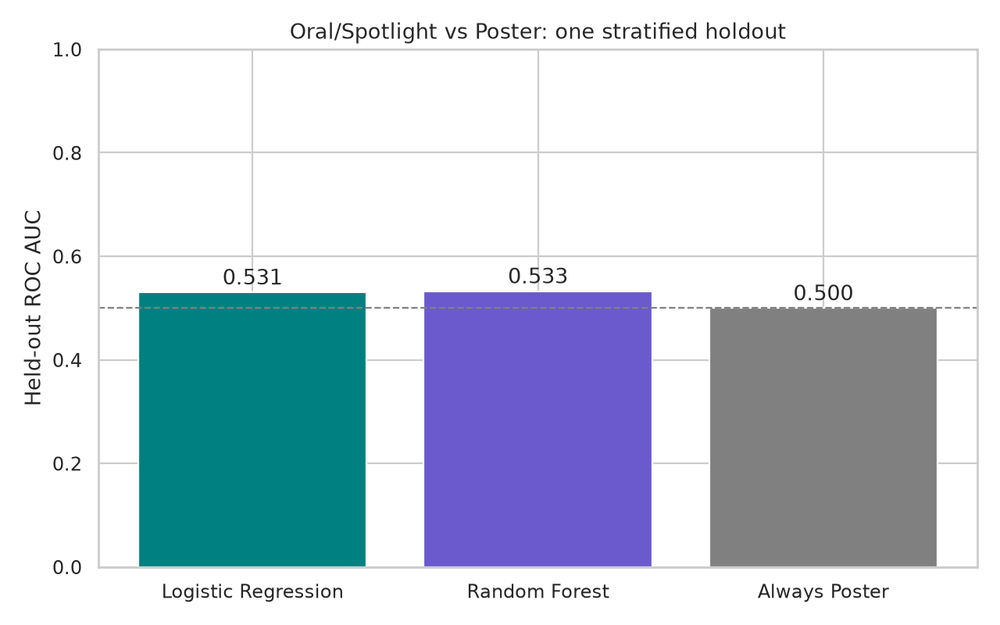

# ICLR Paper Language Analysis

An independently completed student project exploring how abstract wording and author metrics relate to **Oral/Spotlight versus Poster presentation labels among accepted ICLR papers**.

The project combines interpretable text features, TF-IDF, statistical modeling, and visual exploration. It is exploratory observational analysis. It does not predict acceptance versus rejection or establish that promotional wording causes a presentation outcome.

## What the code does

- Measures promotional-word frequency using a small manually specified vocabulary.
- Extracts word/sentence counts, VADER sentiment, and handcrafted certainty/achievement word counts. These dictionaries are not the licensed LIWC system.
- Fits a statsmodels logistic regression using numeric features and reports coefficients, odds ratios, and exploratory p-values.
- Fits a balanced random forest with 300 trees using numeric features plus up to 150 TF-IDF terms.
- Uses one shared stratified 75/25 holdout with seed 42. The vocabulary and numeric scaler are fitted on training rows only.
- Describes a nearest-neighbor covariate-matched rate contrast and year-specific logistic associations.
- Produces distributions, group comparisons, descriptive trends, a word cloud, bigram counts, a correlation matrix, and pairwise plots.

All 18 code sections of the complete original analysis notebook are retained in [main.ipynb](main.ipynb). Publication fixes are listed in [CHANGELOG.md](CHANGELOG.md). Historical notebook outputs and personal metadata are cleared.

## Observed local result

A full local run used 5,963 accepted papers from 2024–2025, with 4,472 training and 1,491 held-out papers. Logistic regression achieved held-out ROC AUC **0.5305** and random forest **0.5327**. Both had accuracy **0.8236**, slightly below an always-Poster baseline (**0.8243**, AUC 0.5). These features therefore showed weak discrimination in this split; the project demonstrates an exploratory workflow rather than a deployment-ready predictor.



The [aggregate tables and plots](reports/) contain no paper titles, names, IDs, abstracts, individual predictions, or individual scatter points. The notebook retains the original exploratory visualizations, with historical outputs cleared.

## Run the analysis

Python 3.12 is the verified runtime. From the repository root:

```powershell
python -m venv .venv
.venv\Scripts\Activate.ps1
python -m pip install -r requirements.txt
python -m nltk.downloader punkt_tab vader_lexicon
```

The NLTK resources require a one-time download. The notebook itself makes no network requests and calls no external model APIs.

Obtain a suitable CSV as described in [DATA_SCHEMA.md](DATA_SCHEMA.md). Place it at `data/iclr_cleaned_v1_20250322.csv`, or point to a local copy:

```powershell
$env:ICLR_DATA_PATH = "C:\path\to\iclr_cleaned_v1_20250322.csv"
jupyter lab main.ipynb
```

Select **Restart Kernel and Run All Cells**. The working directory must be the repository root. Results are written to the ignored `results/` folder. Do not commit raw data or newly executed notebook outputs containing individual records. The loader selects only the six documented analysis fields and excludes names, titles, and identifiers.

## Validation without real data

After installing the scientific Python dependencies:

```powershell
python validate.py
```

This offline check compiles every notebook code cell, checks the clean notebook, validates the data allowlist and invalid inputs, and executes the actual model-preparation, logistic, random-forest, matching, and yearly-analysis code on synthetic features. It verifies that a token appearing only in held-out rows cannot enter the vocabulary, that scaling uses training rows, that labels remain aligned, and that a vocabulary smaller than 150 terms works.

The synthetic check does not validate research findings or exercise real VADER/tokenization, WordCloud, or all visualization sections. See [VALIDATION.md](VALIDATION.md) for the separate local-data reproduction record.

## Interpretation and limitations

- The local project dataset contains accepted papers only. The binary label is 1 for Oral/Spotlight and 0 for Poster; it provides no evidence about rejected submissions.
- Handcrafted dictionaries are short, approximate measures. The promotional ratio uses whitespace token matching, so punctuation and inflection can affect counts. VADER is a general sentiment tool rather than an academic-writing-specific measure.
- The random split measures discrimination within this sample, not future-year performance. Collection timing for author metrics is undocumented, so contemporaneous availability cannot be assumed.
- Logistic regression and random forest use different feature sets. Their comparison describes two configurations, not an isolated algorithm improvement. There is no hyperparameter search, repeated split, or cross-validation.
- The matching analysis uses standardized covariates, one nearest neighbor, and replacement. It estimates no propensity scores, applies no caliper, and supplies no balance or uncertainty assessment. Its rate contrast is descriptive, not an identified causal effect.
- Groupwise slopes and year-specific fits are exploratory. There is no formal interaction test or multiple-comparison correction. Main-model coefficients use training-standardized numeric units; year-specific coefficients use raw units.

## Files

| File | Purpose |
| --- | --- |
| `main.ipynb` | Complete analysis workflow and plots |
| `validate.py` | Offline synthetic checks against actual notebook code |
| `requirements.txt` | Python dependency ranges |
| `DATA_SCHEMA.md` | Required fields, input assumptions, and data provenance |
| `VALIDATION.md` | What was actually verified |
| `CHANGELOG.md` | Changes made while preparing the public project |
| `reports/` | Curated aggregate results from the documented local run |

The code was completed independently. Raw data, external NLP resources, local environments, and author-identifying records are not distributed.
